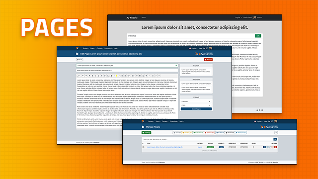
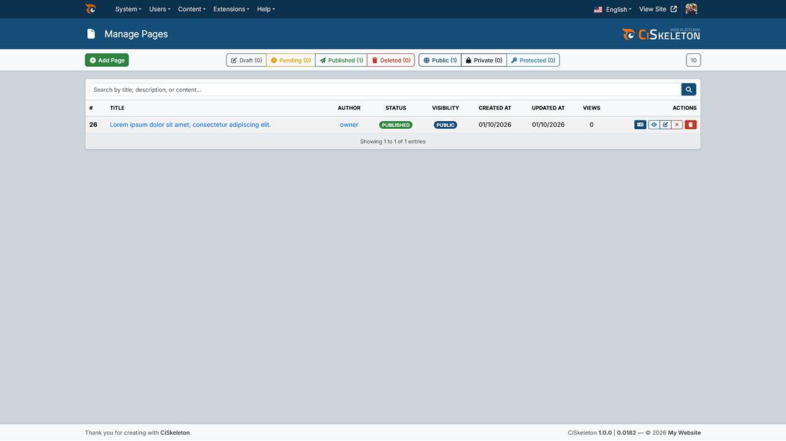
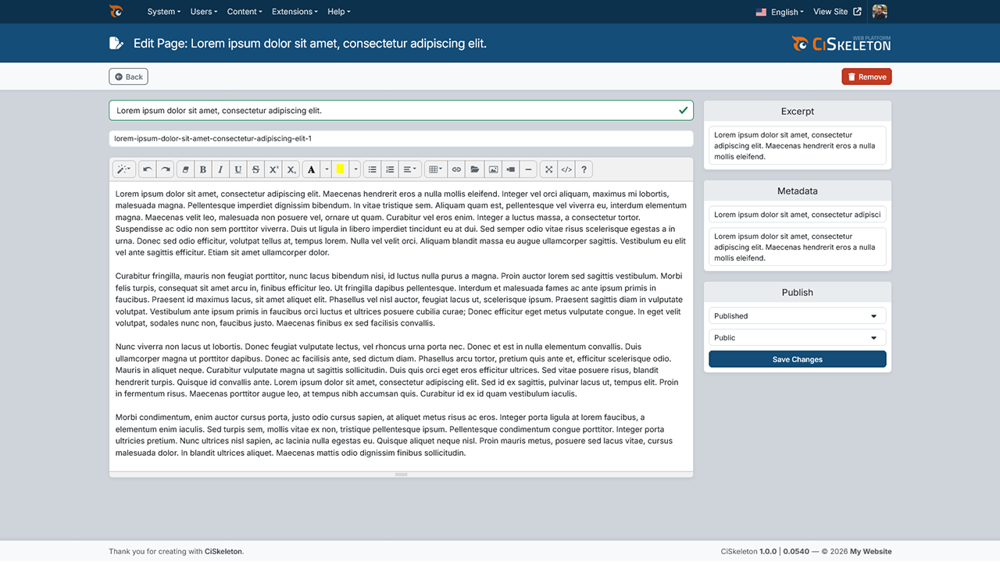
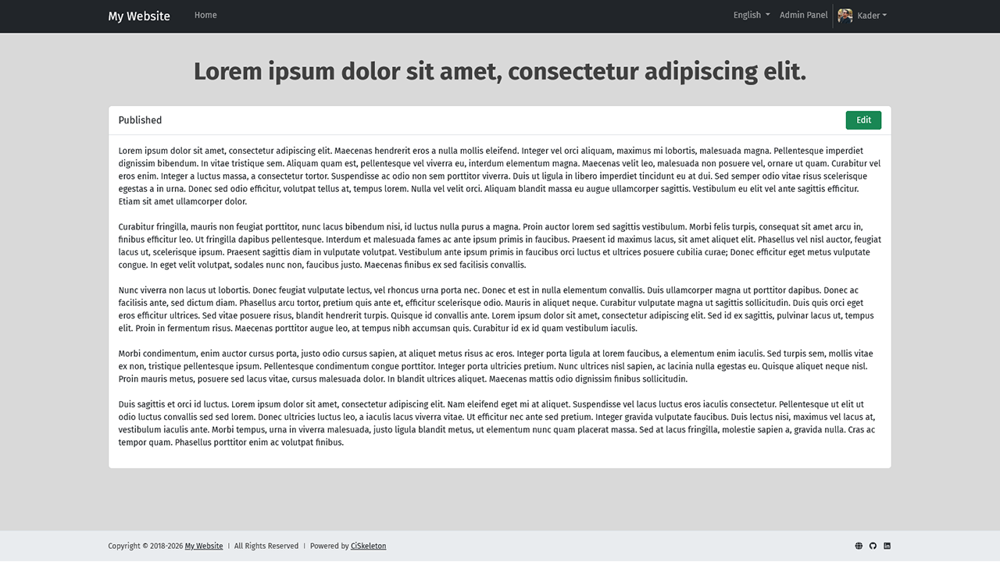

# CiSkeleton Module — Pages

  

The Pages module adds static page management to CiSkeleton.

It is intended for content that should live outside the blog flow, such as:
- About pages
- Policy and legal pages
- Landing pages
- Help pages
- Standalone site content

## What the Module Adds

The module manages a single page entity type and provides:
- Front-end rendering for static pages
- An admin dashboard for creating and editing pages
- Status and visibility controls
- SEO-oriented metadata fields
- Per-page password protection
- Multilingual page translation support
- View counting for public page visits

## Public Route

The module registers a front-end route under:

- `/page/{slug}`

That route loads a single page by its slug and renders it with page metadata and a `WebPage` schema payload.

## Access and Visibility

Pages use the same publishing and visibility concepts found elsewhere in CiSkeleton.

### Status

Pages can be stored as:
- Draft
- Pending
- Published

Deleted pages are also tracked through soft deletion in the admin interface.

### Visibility

Pages support three visibility modes:
- Public
- Private
- Password protected

The public controller applies different access rules depending on the current visitor:
- Guests can only access public, published, non-deleted pages
- Authenticated non-staff users can access private and public pages that are published and not deleted
- Staff users can access broader page states for review and management

## Front-End Behavior

When a page is requested, the module:
- Resolves the slug to a page entity
- Applies visibility and status checks
- Increments the page view count when appropriate
- Sets meta information from the page entity
- Registers structured data as `WebPage`
- Renders the page title and page content

If a staff user is viewing a page on the front end, the rendered page also includes a small status bar with:
- Current page state
- A direct edit link back to the dashboard

## Admin Area

The module adds a `Pages` link under the dashboard content menu.

This menu item is restricted to `UserLevel::ADMIN`, while some moderation actions inside the controller are available to staff-level users and some destructive actions require admin privileges.

### Page Management

From the dashboard, users can:
- List pages
- Search pages by title, description, or content
- Sort pages by common fields including title, dates, and views
- Filter pages by:
  - Author
  - Status
  - Visibility
- Create new pages
- Edit existing pages
- Translate existing pages into other enabled languages
- View pages on the front end
- Delete, restore, or permanently remove pages

### Page Form Fields

The add/edit form supports:
- Title
- Slug
- Main content
- Excerpt/description
- Meta title
- Meta description
- Status
- Visibility
- Password for protected pages

The content editor uses Summernote in the dashboard.

## Translation Support

The module supports multilingual page content when the site language system is enabled.

That includes:
- Admin UI language files per language
- Translating existing pages from the dashboard
- Loading translated page content when editing a translation directly
- Removing individual translations without deleting the original page

When translating a page, some fields are intentionally excluded from the translation form because they belong to the original page record rather than the translated content, including:
- Slug
- Visibility
- Status
- Password

## Validation and Content Rules

The module defines validation for page creation and editing, including rules for:
- Title length
- Slug format and uniqueness
- Required content
- Excerpt length
- Meta field lengths
- Allowed visibility values
- Allowed status values
- Password strength for protected pages

## Developer Notes

The module exposes its page entity driver through:

- `$this->app->pages`

This driver is responsible for page entity operations and sorting support. It also ensures that new pages automatically:
- Get a slug from the page name when one is not provided
- Use the current user as owner when no owner is provided
- Start with a `views` counter

Key module files include:
- `src/config/routes.php` for front-end routing
- `src/config/admin_menus.php` for dashboard registration
- `src/config/form_rules.php` for page validation
- `src/controllers/Pages.php` for public rendering
- `src/controllers/Admin.php` for dashboard management
- `src/libraries/App/drivers/App_pages.php` for page entity behavior

## In Practice

Use this module when you need managed, non-blog content pages that still behave like first-class CiSkeleton entities.

It is a good fit for sites that need:
- Standalone informational pages
- Access-controlled static content
- Translatable page content
- Simple dashboard editing for staff or admins
- Searchable and filterable page management inside the CMS

## Screenshots

  
<b>Pages — List</b>

   
  

  
<b>Pages — Editor</b>

   
  

  
<b>Pages — Frontend</b>

   
  

## License

MIT License. See [LICENSE](LICENSE.md) for details.

---

  <a href="https://github.com/ciskeleton">CiSkeleton</a> is created, developed, and maintained by <a href="https://github.com/bkader">Kader Bouyakoub</a>, trading as <a href="https://github.com/ianhubnet">Ianhub</a>.

